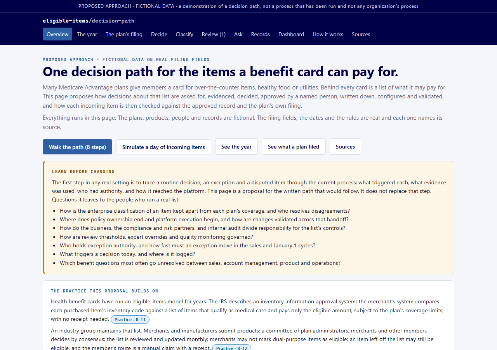
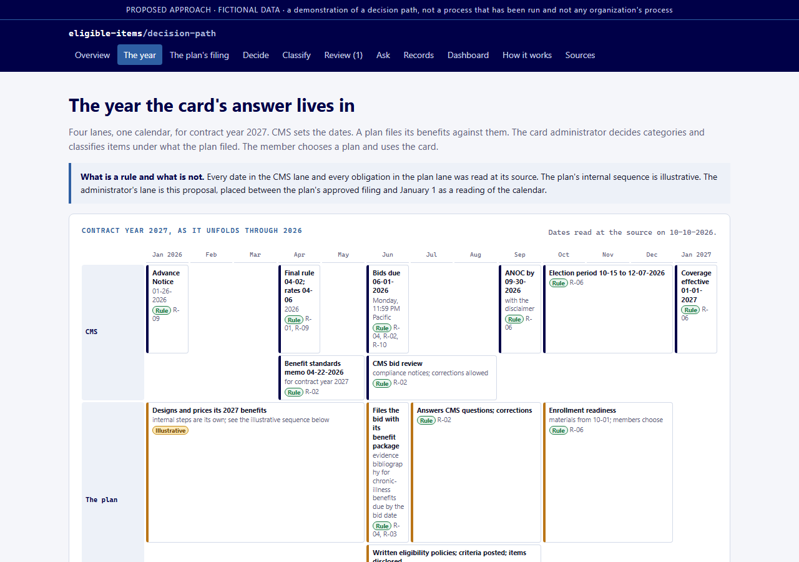
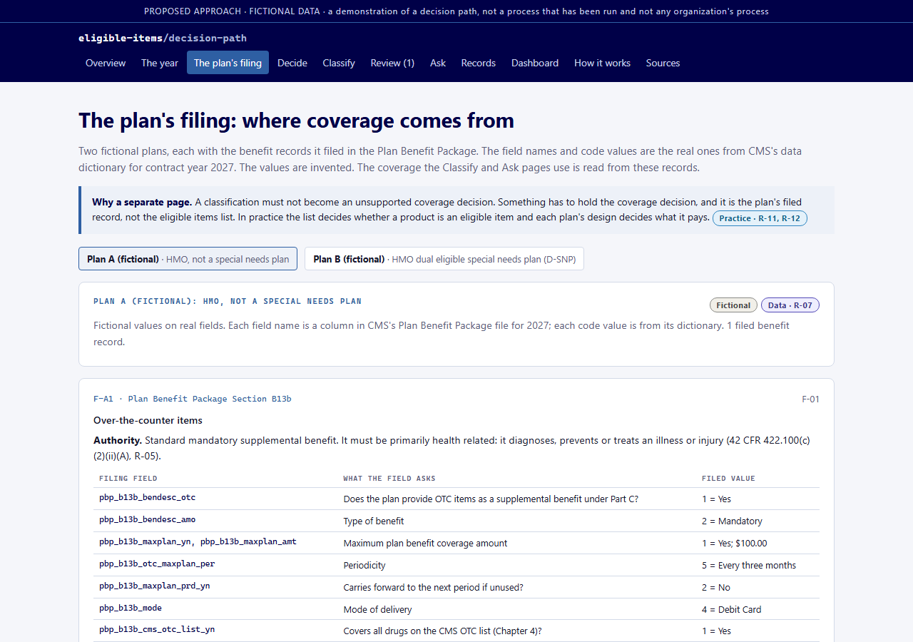
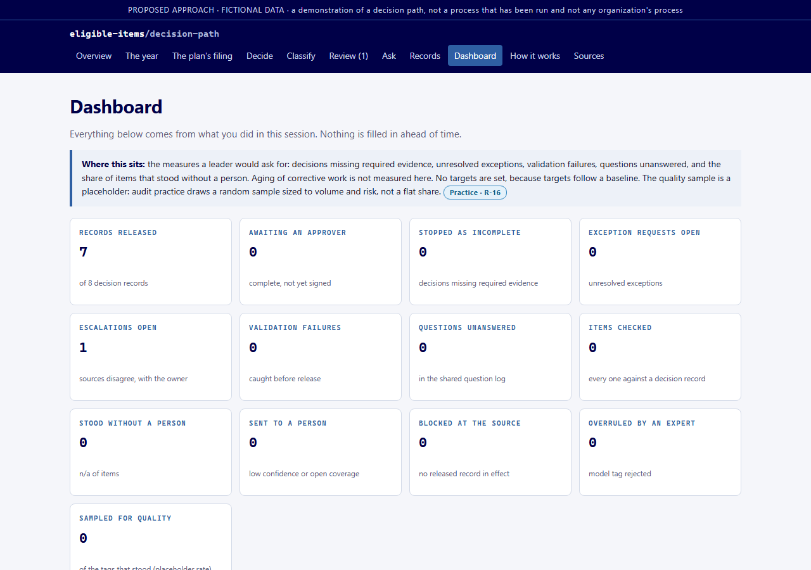

# Eligible Items Decision Path

**A proposed decision path for the eligible items list behind a health plan benefit card: who decides what the card may pay for, on what evidence, with what record, and how each decision stays explainable to a plan or a regulator.**

This repository is the public description of a runnable, single-file demonstration. The demonstration itself is held privately; a walkthrough is available on request through the contact on the [Lab site](https://framework-optimization-lab.github.io/tania-mason-site/).

Every page of the demonstration carries the same band: *proposed approach, fictional data, a demonstration of a decision path, not a process that has been run and not any organization's process.*

## The problem it addresses

A health plan benefit card pays at the register only for items on an eligible items list. That list is where three things meet: the benefit the plan filed with the regulator, the rules the regulator sets for what a card may pay for, and a member's purchase. Keeping the list right is a governance problem before it is a technology problem:

- a category goes on the list only under a benefit the plan actually filed, under the authority that benefit carries, with the evidence written down;
- someone named signs the decision, with reasons and an effective date, and the record of it is what the card is configured from;
- an item the list has not decided becomes a question with an owner, never a guess at the register;
- anything that classifies items automatically works inside a threshold a person set, and anything it is unsure of goes to a person;
- all of it sits on the calendar of a contract year, because a plan's benefit is fixed in June, described to members by the end of September, chosen in the autumn, and must work on January 1.

The demonstration makes each of those a visible, testable step.

## What the demonstration shows

| Page | What a visitor sees |
|---|---|
| **Overview** | The questions to learn before changing anything, the public practice the proposal builds on, and an eight-step walk through one decision and one item. |
| **The year** | A contract year in four lanes: the regulator, the plan, the card administrator and the member. The regulator's dates and the plan's obligations are rules with sources; the plan's internal sequence is marked illustrative. |
| **The plan's filing** | Two fictional plans and the benefit records they filed, on the real public filing fields, with the counts from the public filing data for the year. |
| **Decide** | A category decision request checked against its record: incomplete, escalate, or ready for a named approver. |
| **Classify** | An item's tag checked against the approved record and the plan's coverage: stands, to a person, or blocked. The threshold is adjustable. |
| **Review** | Named sign-off with role, reasons and effective date; escalations where sources disagree; expert confirm or overrule; coverage questions logged for the plan. |
| **Ask** | Answers only from a released record; anything else is logged as a question with an owner. |
| **Records** | The decision record, then configure and validate, with a deliberate-error path. |
| **Dashboard** | The measures, the shared question log, the item trail and the audit trail; a simulated day streams invented items through the real checks. |
| **How it works** | Where each check comes from and how it would be tested. |
| **Sources** | Every rule and practice statement with what it says and the date it was read. A record may cite only a source listed there. |

### Screenshots

| | |
|---|---|
|  |  |
|  |  |

The decision, classification, review and record pages are shown in the walkthrough, not here.

## How to read the marks

Every check, record, box and source in the demonstration carries one of six marks.

| Mark | Meaning |
|---|---|
| **Rule** | A regulation or an agency document, read at the source on the date shown. |
| **Practice** | How a named public body or standard describes the work, from its own published document. |
| **Data** | A count computed from a public data file. |
| **Design choice** | A choice this proposal makes where no rule or published practice decides it. |
| **Illustrative** | A sequence shown for orientation, not asserted as fact. |
| **Fictional** | Invented for the demonstration. |

## What is real and what is simulated

The demonstration is one self-contained HTML file: no backend, no build step, no model, no external dependencies. Everything that decides an outcome is deterministic logic, and the data it runs on is fictional. The rules and dates were read at their public sources, the regulation, the agency's rule and memoranda, the Internal Revenue Service notice on card substantiation, the industry eligible-product-list operator's published practice, and the standards bodies' own documents, and the Sources page says when each was read. The counts were computed from the agency's public filing data for contract year 2027. The plans, their records, the items and the simulated day are invented, on the real public filing fields.

The decision-record discipline follows
[`ai-decision-governance-gate`](https://github.com/framework-optimization-lab/ai-decision-governance-gate);
the named-review and audit-trail pattern follows
[`governance-control-tower`](https://github.com/framework-optimization-lab/governance-control-tower).

All plan data is fictional. Clean-room demonstration only. This is a proposed approach to a decision path, not a description of any organization's process.

## Access

The runnable demonstration is kept in a private repository and is shown by invitation. To ask for a walkthrough, use the contact on the [Lab site](https://framework-optimization-lab.github.io/tania-mason-site/).
